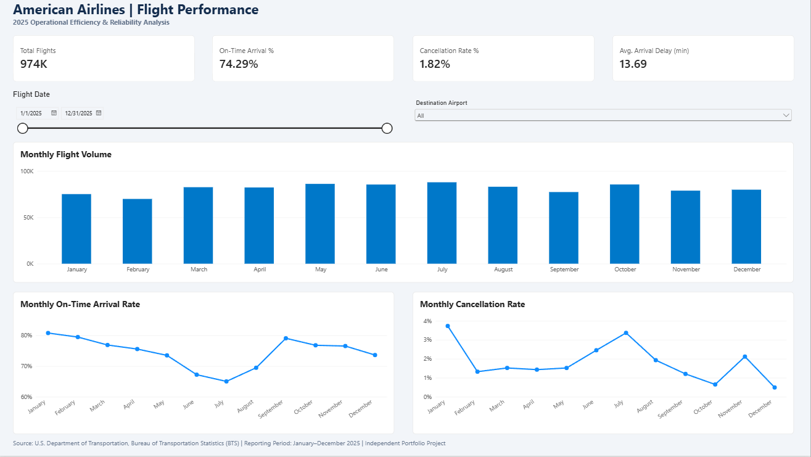
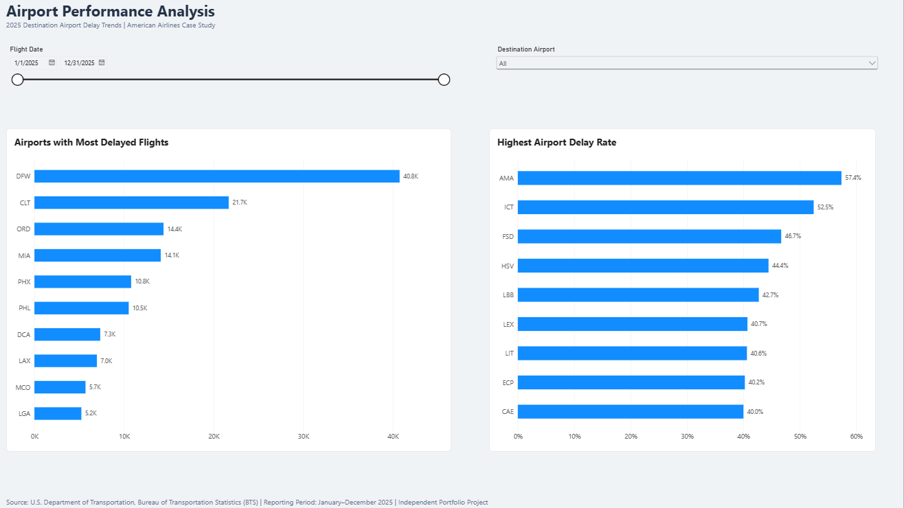
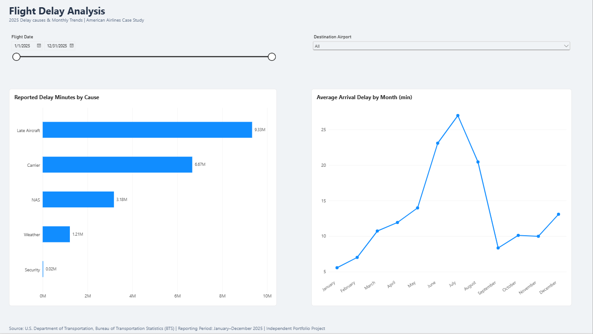

# American Airlines Flight Performance Analysis | Power BI

## Project Overview

This independent data analytics project examines **American Airlines' flight performance throughout 2025** using publicly available data from the U.S. Department of Transportation's Bureau of Transportation Statistics (BTS).

Using **Power BI, Power Query, and DAX**, I analyzed **973,653 flight records** to evaluate operational reliability, identify flight delay patterns, and compare performance across months and destination airports.

The objective was to transform raw aviation data into an interactive dashboard that highlights key performance indicators (KPIs), operational trends, and opportunities for further investigation.

## Tools & Technologies

- **Power BI Desktop:** Dashboard development and interactive data visualization
- **Power Query:** Data cleaning, filtering, transformation, and dataset consolidation
- **DAX (Data Analysis Expressions):** Custom measures and KPI calculations
- **Data Analysis:** Trend analysis, operational performance comparisons, and data validation
- **GitHub:** Project documentation and portfolio presentation

## Dashboard Overview

The Power BI report contains **three interactive dashboard pages** with date and destination airport filtering.

### 1. Executive Overview

Provides a high-level summary of American Airlines' flight operations throughout 2025.

**Key metrics and visualizations:**
- Total flight records
- On-time arrival percentage
- Cancellation rate
- Average arrival delay
- Monthly flight volume
- Monthly on-time performance trends
- Monthly cancellation trends

### 2. Airport Performance

Analyzes flight delays across destination airports to identify locations experiencing higher delay volumes and delay rates.

**Key visualizations:**
- Top 10 destination airports by delayed flight count
- Top 10 destination airports by delay rate
- Interactive filtering by flight date and destination

A minimum threshold of **100 arrived flights** was applied to the delay-rate comparison to reduce the influence of very small sample sizes.

### 3. Flight Delay Analysis

Explores reported flight delay causes and monthly arrival delay patterns.

**Key visualizations:**
- Total reported delay minutes by cause
- Average arrival delay by month
- Interactive date and destination airport filtering

Delay categories include **Late Aircraft, Carrier, National Airspace System (NAS), Weather, and Security**.

## Key Performance Indicators

The following KPIs summarize the analyzed 2025 flight records.

| Metric | 2025 Result |
|---|---:|
| Total Flight Records | 973,653 |
| On-Time Arrival Rate | 74.29% |
| Cancellation Rate | 1.82% |
| Average Arrival Delay | 13.69 minutes |

## Key Findings

### 1. July Experienced the Weakest On-Time Performance

July recorded the **highest monthly flight volume** and **lowest on-time arrival percentage**.

| Metric | July 2025 |
|---|---:|
| Total Flight Records | 87,852 |
| On-Time Arrival Rate | 65.02% |
| Cancellation Rate | 3.37% |
| Average Arrival Delay | 26.98 minutes |

July's on-time arrival rate was **9.27 percentage points below the annual average**, indicating a period of significantly reduced arrival reliability.

The combination of higher flight volume and weaker punctuality suggests an opportunity to investigate operational capacity, scheduling, and delay propagation. These patterns alone do not establish causation.

### 2. Late Aircraft Delays Were a Major Contributor

Late-arriving aircraft accounted for approximately **9.33 million reported delay minutes** across the analyzed year, representing the largest delay category in the dashboard.

During July alone, late-aircraft delays accounted for approximately **1.36 million reported delay minutes**.

These findings suggest that aircraft turnaround performance and delays carried over from earlier flights are important areas for further operational investigation.

### 3. January Demonstrated Strong Arrival Punctuality

January recorded the highest on-time arrival rate of **80.77%**, compared with July's **65.02%**.

This represents a difference of **15.75 percentage points**.

However, January also recorded a **3.73% cancellation rate**, demonstrating that strong on-time arrival performance does not necessarily indicate stronger performance across every operational reliability measure.

Evaluating multiple KPIs provides a more complete view of airline performance.

## Potential Business Applications

The dashboard demonstrates how flight performance data can support operational analysis and decision-making.

Potential applications include:

- **Operational Monitoring:** Track monthly performance and identify periods of declining reliability.
- **Airport Performance Analysis:** Compare destination airports to identify locations requiring additional investigation.
- **Delay Analysis:** Examine reported delay categories to understand patterns of operational disruption.
- **Resource Planning:** Provide historical performance insights that may inform scheduling and resource allocation discussions.
- **Performance Reporting:** Communicate complex operational information through accessible dashboards and KPIs.

## Data Source & Methodology

### Data Source

**Source:** [U.S. Department of Transportation — Bureau of Transportation Statistics (BTS)](https://www.bts.gov/)

**Dataset:** [Airline On-Time Performance Data — BTS TranStats](https://www.transtats.bts.gov/ONTIME/)

**Reporting Period:** January–December 2025

The analysis focuses on flight records associated with operating carrier code `AA`. It does not include every flight marketed under the American Airlines brand.

### Data Preparation

1. Collected 12 monthly flight performance datasets covering January–December 2025.
2. Imported and combined the datasets using Power Query.
3. Filtered the records to operating carrier code `AA`.
4. Prepared the data for analysis and created custom DAX measures.
5. Developed interactive Power BI visualizations and report filters.
6. Reviewed monthly totals, checked selected fields for potential duplicate records, and tested report filtering behavior.

### KPI Definitions

- **Total Flights:** Count of flight records in the analyzed dataset.
- **On-Time Arrival Rate:** Percentage of flights with valid arrival-delay data arriving less than 15 minutes late.
- **Cancellation Rate:** Canceled flight records divided by total flight records.
- **Average Arrival Delay:** Mean arrival delay in minutes among records with valid arrival-delay values, including negative values for early arrivals.

These definitions describe the calculations used in this project and should not automatically be interpreted as identical to every officially published BTS performance metric.

## Project Files

- **Power BI Report (.pbix):** Interactive dashboard and underlying analytical model
- **Screenshots/:** Images of the three dashboard pages
- **README.md:** Project documentation, methodology, and key findings

To explore the interactive report, download the `.pbix` file and open it using [Microsoft Power BI Desktop](https://www.microsoft.com/en-us/power-platform/products/power-bi/desktop).

Refreshing the underlying data may require updating local source file paths.

## Project Disclaimer

This is an **independent portfolio project** developed for educational and professional development purposes.

It is **not affiliated with, sponsored by, or endorsed by American Airlines**.

All findings are based on the analyzed public dataset and should be interpreted as descriptive operational insights rather than confirmed explanations of flight delays or cancellations.
